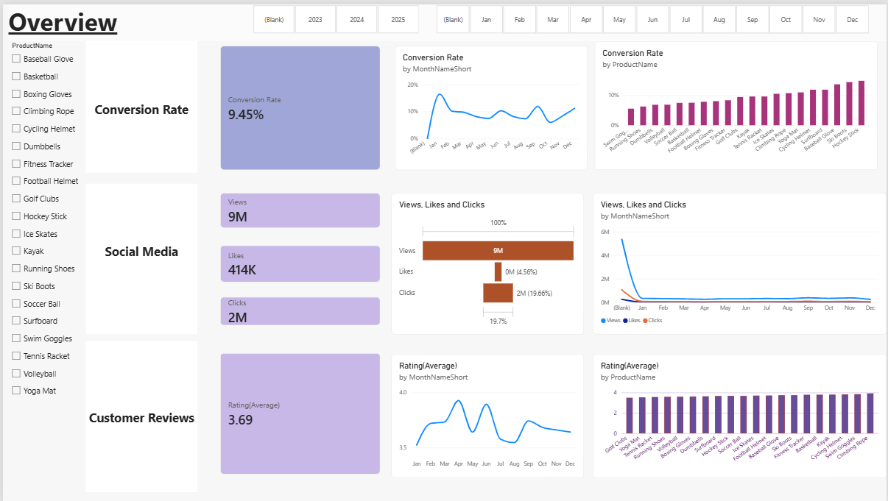
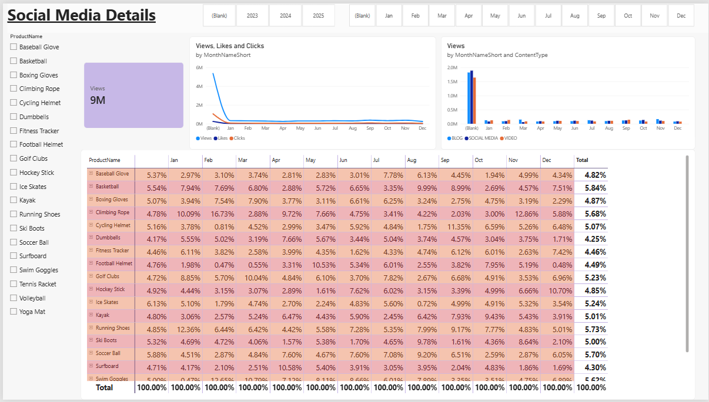
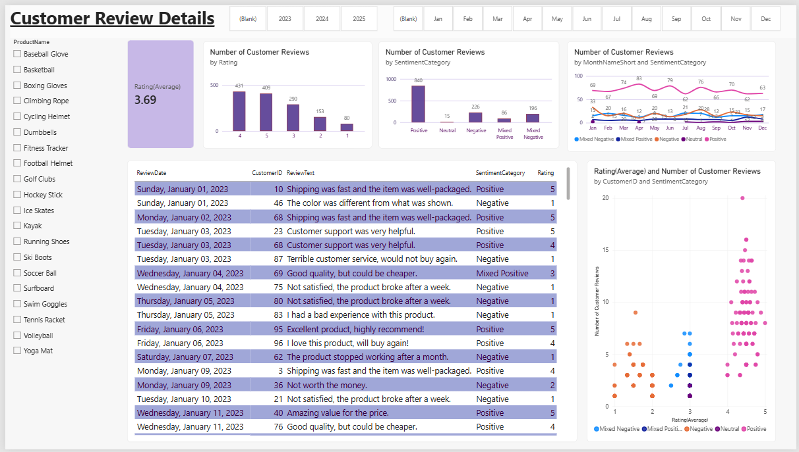
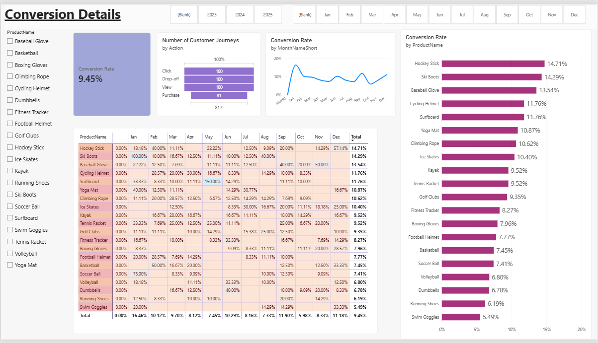

# Marketing Analytics Dashboard

### Overview Dashboard


### Social Media Analytics


### Customer Reviews


### Conversion Details


## Project Overview

This project focuses on analyzing marketing campaign performance, customer behavior, social media engagement, and customer reviews using SQL Server and Power BI.

The goal is to transform raw marketing data into meaningful insights through an interactive dashboard that helps understand campaign effectiveness, customer engagement, and customer satisfaction.

## Tools & Technologies

- **SQL Server** — Data storage and SQL queries
- **SQL Server Management Studio (SSMS)** — Database management and query execution
- **Microsoft Power BI Desktop** — Data visualization and dashboard development
- **DAX** — Measures and KPI calculations
- **GitHub** — Project documentation and portfolio

## Dataset

The project uses six tables:

| Table | Purpose |
|---|---|
| `customer_journey` | Customer interactions and journey activities |
| `customer_reviews` | Customer ratings and written feedback |
| `customers` | Customer information |
| `engagement_data` | Marketing and social media engagement |
| `geography` | Geographical information |
| `products` | Product information |

## Dashboard Features

The dashboard focuses on three main areas:

### 1. Marketing Performance
- Conversion rate
- Customer journey analysis
- Campaign performance indicators

### 2. Social Media Engagement
- Clicks
- Likes
- Views
- Campaign-related engagement metrics

### 3. Customer Reviews
- Average customer rating
- Number of customer reviews
- Customer feedback analysis

## Key Performance Indicators (KPIs)

The project includes measures such as:

- Conversion Rate
- Clicks
- Likes
- Views
- Number of Campaigns
- Number of Customer Journeys
- Number of Customer Reviews
- Average Rating

## Conversion Rate Calculation

The conversion rate is calculated by dividing the number of purchase actions by the number of view actions.

```dax
Conversion Rate =
VAR TotalVisitors =
    CALCULATE(
        COUNT(fact_customer_journey[journeyID]),
        fact_customer_journey[Action] = "View"
    )
VAR TotalPurchases =
    CALCULATE(
        COUNT(fact_customer_journey[journeyID]),
        fact_customer_journey[Action] = "Purchase"
    )
RETURN
    IF(
        TotalVisitors = 0,
        0,
        DIVIDE(TotalPurchases, TotalVisitors)
    )
```

## Project Workflow

1. Loaded the marketing dataset into SQL Server.
2. Explored the tables and data using SQL queries.
3. Connected the data to Power BI Desktop.
4. Created DAX measures for key marketing performance indicators.
5. Developed an interactive marketing analytics dashboard.
6. Prepared the project for portfolio presentation.

## Dashboard Preview

Screenshots of the dashboard will be added here.


## Project Files

- `Marketing_Analytics_Dashboard.pbix` — Power BI dashboard file
- `README.md` — Project documentation
- `images/` — Dashboard screenshots (to be added)

## Key Learnings

- Working with relational marketing datasets
- Writing and exploring SQL queries
- Creating DAX measures in Power BI
- Designing KPI cards and data visualizations
- Analyzing marketing performance and customer engagement
- Presenting data insights through dashboards

## How to View the Project

1. Browse the dashboard screenshots in this repository.
2. Download the `.pbix` file.
3. Open it using Microsoft Power BI Desktop to explore the report.

## Author

**Marufa Akter Meem**


---

*This project was developed as part of my data analytics learning and portfolio journey.*
